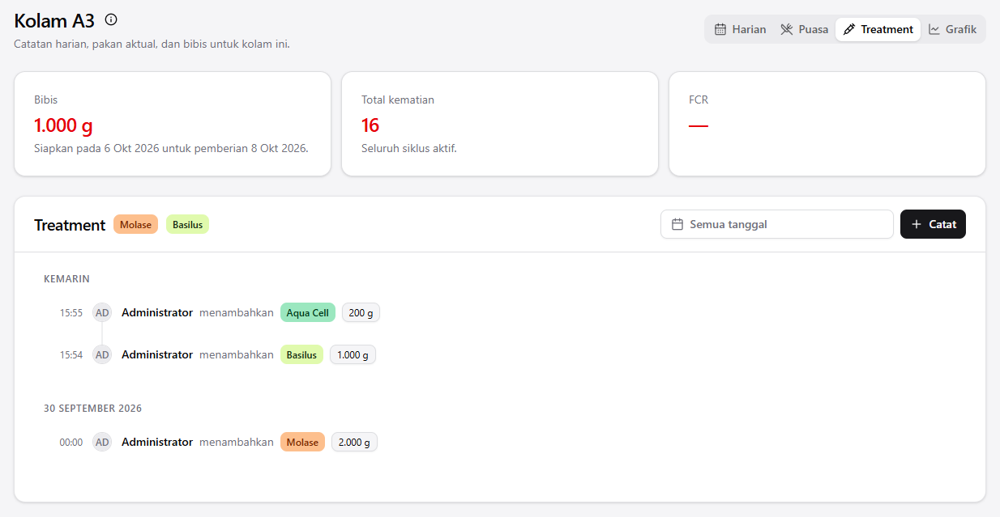

# Arunika Dashboard

Arunika Dashboard keeps a fish farm's pond record in one app: growth, feed, fasting, treatments, and the work of the day. It is being built for our own eight-pond tilapia farm, where we are also trying biofloc. A farm is meant to run its own copy.

The app is actively developed. A license has not been chosen, so this repository is not open source yet and reuse is not permitted. There is no hosted demo, and no other farm has been onboarded.

## What you are looking at



Treatment timeline on a pond page. The rows are Storybook fixtures, not an export of the live farm. More views are in the [screenshot gallery](docs/screenshots/README.md). A click-by-click walkthrough is in [docs/demo.md](docs/demo.md).

## Problem

Daily pond history is easy to lose when it lives in a workbook. Growth, feed, fasting, and stock then have to be reconstructed by hand. Arunika is the app we are building so that record stays in one place. That is the motivation. It is not a measured claim about other farms.

## Features

Status words match [docs/roadmap.md](docs/roadmap.md). A row is included only when the code or those docs support it.

| Feature                              | Status      | Description                                                                                                                                                  |
| ------------------------------------ | ----------- | ------------------------------------------------------------------------------------------------------------------------------------------------------------ |
| Sign-in                              | Implemented | Username and password. Email is stored and is not the login field. Public sign-up is off.                                                                    |
| Beranda                              | Partial     | User count, unexpired session count, and the feed-name list. Unused feeds can be deleted. Not an operations dashboard.                                       |
| Kolam daily log                      | Implemented | Today's weight, deaths, and actual feed, plus a historical day that replaces an existing date only after confirmation. Derived figures are calculated again. |
| Puasa dadakan                        | Implemented | Record or end an exception fast. The recurring pattern is imported, not edited on screen.                                                                    |
| Bibis                                | Partial     | Today's feed-to-prepare is shown. It is not entered in the UI.                                                                                               |
| Treatment log                        | Implemented | Timeline for the cycle, with add, edit, soft revoke, a date range, and infinite scroll. Planned treatments are labels only.                                  |
| Grafik                               | Implemented | Biomass and that day's deaths for the active cycle. An empty range is the whole cycle.                                                                       |
| Feed stock                           | Partial     | Receipts, applications, and stock counts are models. The screen is the feed-name list only.                                                                  |
| Fish purchasing and sales            | Planned     | Decided for this app. No model and no screen.                                                                                                                |
| Water quality, harvest, cost, alerts | Proposed    | Not modeled.                                                                                                                                                 |
| Translations                         | Planned     | Screen copy is Indonesian. There is no translation catalog.                                                                                                  |
| Open-source license                  | Planned     | Not chosen. Do not treat the source as reusable.                                                                                                             |

## Stack

| Piece                                                                                  | Role                                         |
| -------------------------------------------------------------------------------------- | -------------------------------------------- |
| [TanStack Start](https://tanstack.com/start) and [Router](https://tanstack.com/router) | File routes, server functions, selective SSR |
| [TanStack Query](https://tanstack.com/query), Form, Table, Charts                      | Server cache, forms, tables, biomass chart   |
| [React 19](https://react.dev)                                                          | UI, with the React Compiler                  |
| [Tailwind CSS 4](https://tailwindcss.com) and [shadcn/ui](https://ui.shadcn.com)       | Styling and primitives                       |
| [Zustand 5](https://zustand.docs.pmnd.rs)                                              | Theme and sidebar, in the browser            |
| [Better Auth](https://www.better-auth.com)                                             | Username and password sessions               |
| [Prisma 7](https://www.prisma.io) and PostgreSQL 18                                    | Database                                     |
| [Zod 4](https://zod.dev)                                                               | Request and response schemas                 |
| [Storybook 10](https://storybook.js.org) and Vitest                                    | Stories and domain tests                     |
| [Nitro](https://nitro.build)                                                           | Production Node server (beta pin)            |
| pnpm 11.4.0 and Node 24                                                                | Package manager and runtime                  |

Pages render in the browser. The first request can still read the session and redirect. Private data goes through `authMiddleware` on server functions. Detail is in [docs/architecture.md](docs/architecture.md).

## Quick start

You need Node.js 24, pnpm 11 (`corepack enable && corepack prepare pnpm@11.4.0 --activate`), and Docker Desktop.

```powershell
Copy-Item .env.example .env
```

```bash
cp .env.example .env
```

Generate a secret and put it in `BETTER_AUTH_SECRET`:

```bash
pnpm dlx @better-auth/cli secret
```

Set `SEED_ADMIN_PASSWORD` in `.env`. The seed refuses to run when that value is empty. Do not commit `.env` or paste the password into docs.

```bash
pnpm install
pnpm db:up
pnpm db:migrate
pnpm db:seed
pnpm dev
```

Open http://localhost:3000 and sign in with `SEED_ADMIN_USERNAME` (default `admin`) and the password you set. The seed creates Nila, Biofloc, and that account. It does not create pond history. `pnpm db:import` loads BATCH 1 from the workbook in this repo and replaces those cycles.

Every script, the environment table, and troubleshooting are in [docs/development.md](docs/development.md).

| Script                                            | What it does                                                                 |
| ------------------------------------------------- | ---------------------------------------------------------------------------- |
| `pnpm dev`                                        | Dev server on port 3000                                                      |
| `pnpm build` / `pnpm start`                       | Production build, then `node .output/server/index.mjs`                       |
| `pnpm typecheck`                                  | `tsc --noEmit`                                                               |
| `pnpm lint` / `pnpm check`                        | ESLint, and Prettier check                                                   |
| `pnpm test:unit`                                  | Domain tests in Node. The treatment server test skips without `DATABASE_URL` |
| `pnpm test:stories`                               | Stories in a headless browser. Local; needs Playwright                       |
| `pnpm storybook`                                  | Storybook on port 6006                                                       |
| `pnpm db:up` / `pnpm db:migrate` / `pnpm db:seed` | Postgres, schema, Nila, Biofloc, administrator                               |
| `pnpm db:import`                                  | Load BATCH 1. Replaces those cycles                                          |
| `pnpm user:create`                                | Add a user who can sign in                                                   |

## Status and limits

- Built for our farm. Eight ponds, tilapia, and a biofloc experiment. The app does not claim a better harvest.
- One account type. Anyone who can sign in can do the same work. There is no farm switcher.
- History for BATCH 1 comes from the workbook import. Re-running `pnpm db:import` replaces those cycles and does not write puasa dadakan.
- Nitro is a beta dependency.
- Checks run locally: `pnpm lint`, `pnpm typecheck`, `pnpm test:unit`, and `pnpm build`. There is no GitHub Actions workflow. Story tests stay local.
- Open product questions are in [docs/product.md](docs/product.md).

## Project layout

```
src/routes/            guards, loaders, titles
src/features/<name>/   api, components, hooks, schemas
src/components/ui/     shadcn primitives
src/components/layout/ app shell
src/components/shared/ used by more than one feature
prisma/                schema, migrations, seed
scripts/               import and user creation
docs/                  product, architecture, roadmap, demo
```

Imports go one way: routes, then features, then shared folders. A feature does not import another feature or a route. Import with the `#/` alias. `*.server.ts` is server-only. `*.functions.ts` holds `createServerFn` wrappers.

## Community

| Doc                                                      | Purpose                                         |
| -------------------------------------------------------- | ----------------------------------------------- |
| [CONTRIBUTING.md](CONTRIBUTING.md)                       | How to set up and open a change                 |
| [SECURITY.md](SECURITY.md)                               | How to report a vulnerability                   |
| [docs/demo.md](docs/demo.md)                             | Walkthrough of the working screens              |
| [docs/screenshots/README.md](docs/screenshots/README.md) | Gallery and how the images were captured        |
| [docs/roadmap.md](docs/roadmap.md)                       | What is shipped, in progress, and only proposed |
| [docs/development.md](docs/development.md)               | Setup, scripts, checks                          |
| [docs/architecture.md](docs/architecture.md)             | Request path, data, security                    |
| [docs/product.md](docs/product.md)                       | Problem, users, and open questions              |
| [docs/ai-engineering.md](docs/ai-engineering.md)         | How agents should change this repo              |

There is no `LICENSE` file. Do not copy, modify, or redistribute this source until one is added.
