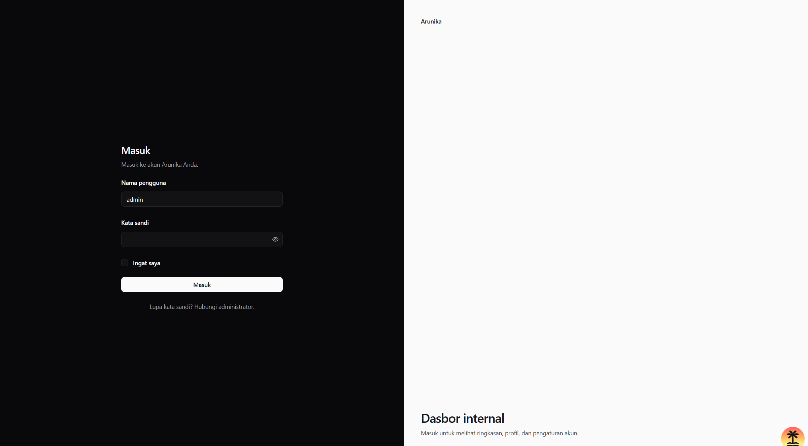
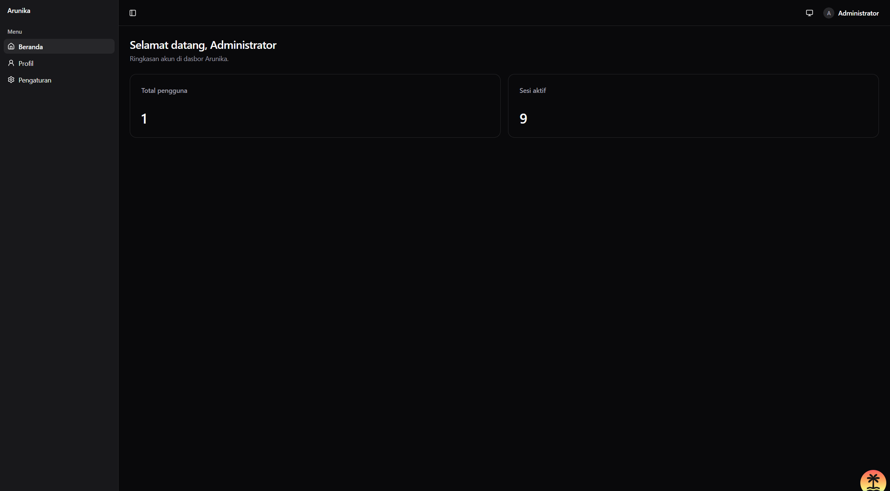
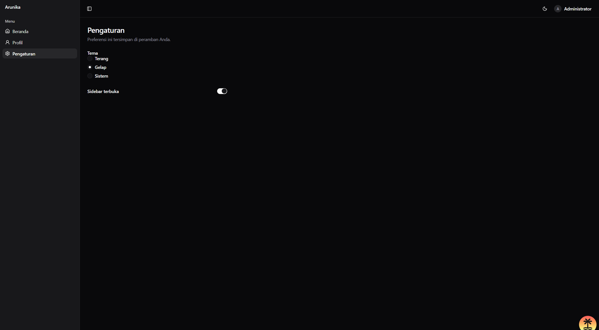
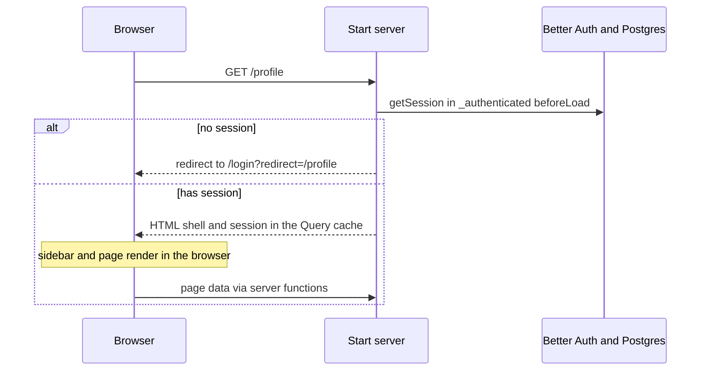

# Arunika Dashboard

Internal dashboard for Arunika. People sign in with an administrator account, then use the app as a single-page app. The server only checks the session and redirects; page HTML is rendered in the browser.







The interface is Indonesian. Code, file names, and this document are English.

## Features

- Username and password login. Email is required account information, not the sign-in field. Public sign-up is disabled. The first administrator is created by the database seed.
- SPA rendering. Only the root route and the auth layouts run on the server, and only to read the session.
- Guarded pages: Beranda (protected summary), Profil (session details), and Pengaturan (theme and sidebar).
- Theme and sidebar state saved in the browser with Zustand.
- A Storybook story next to every component.
- Docker Compose for local Postgres, plus a production image that runs the app and the database together.

## Tech stack

| Piece                                                                                | Role                                         |
| ------------------------------------------------------------------------------------ | -------------------------------------------- |
| [TanStack Start](https://tanstack.com/start) / [Router](https://tanstack.com/router) | File routes, server functions, selective SSR |
| [TanStack Query](https://tanstack.com/query)                                         | Server data cache                            |
| [TanStack Form](https://tanstack.com/form)                                           | Login form                                   |
| [React 19](https://react.dev) + React Compiler                                       | UI                                           |
| [Tailwind CSS 4](https://tailwindcss.com) + [shadcn/ui](https://ui.shadcn.com)       | Styling and primitives                       |
| [Zustand 5](https://zustand.docs.pmnd.rs)                                            | Shared UI state (theme, sidebar)             |
| [Better Auth](https://www.better-auth.com)                                           | Sessions, username and password              |
| [Prisma 7](https://www.prisma.io) + PostgreSQL 18                                    | Database                                     |
| [Storybook 10](https://storybook.js.org) + Vitest                                    | Component stories and tests                  |
| [Nitro](https://nitro.build)                                                         | Production Node server                       |
| pnpm 11, Node 24                                                                     | Package manager and runtime                  |

## Quick start

You need Node.js 24, pnpm 11 (`corepack enable && corepack prepare pnpm@11.4.0 --activate`), and Docker Desktop.

```powershell
Copy-Item .env.example .env
```

```bash
cp .env.example .env
```

Generate a secret and put it in `BETTER_AUTH_SECRET`:

```bash
pnpm dlx @better-auth/cli secret
```

Set `SEED_ADMIN_PASSWORD` in `.env` to the administrator password you want. The seed refuses to run when that value is empty.

```bash
pnpm install
pnpm db:up
pnpm db:migrate
pnpm db:seed
pnpm dev
```

Open http://localhost:3000 and sign in with `SEED_ADMIN_USERNAME` (default `admin`) and the password you set. Email stays on the account (`SEED_ADMIN_EMAIL`) and is not the login field.

`pnpm db:migrate` on a fresh database creates the tables. Later schema changes use the same command with a name: `pnpm exec prisma migrate dev --name <change>`.

## Environment variables

| Name                  | Required     | Default                 | Purpose                                                              |
| --------------------- | ------------ | ----------------------- | -------------------------------------------------------------------- |
| `POSTGRES_USER`       | no           | `arunika`               | Database user for Docker                                             |
| `POSTGRES_PASSWORD`   | no           | `arunika`               | Database password for Docker                                         |
| `POSTGRES_DB`         | no           | `arunika`               | Database name for Docker                                             |
| `POSTGRES_PORT`       | no           | `5432`                  | Host port for Postgres                                               |
| `APP_PORT`            | no           | `3000`                  | Host port for the production app container                           |
| `DATABASE_URL`        | yes          | local Postgres URL      | Connection string used by Prisma and the app                         |
| `BETTER_AUTH_SECRET`  | yes          | none                    | Session signing secret, at least 32 characters                       |
| `BETTER_AUTH_URL`     | yes          | `http://localhost:3000` | Public origin of the app. Keep this in sync with the dev server port |
| `SEED_ADMIN_NAME`     | no           | `Administrator`         | Display name of the seeded admin                                     |
| `SEED_ADMIN_USERNAME` | no           | `admin`                 | Username used to sign in                                             |
| `SEED_ADMIN_EMAIL`    | no           | `admin@arunika.local`   | Email stored on the seeded admin                                     |
| `SEED_ADMIN_PASSWORD` | yes for seed | none                    | Password of the seeded admin                                         |

`.env` is gitignored. `.env.example` is the committed template.

## Scripts

| Script                 | What it does                                  |
| ---------------------- | --------------------------------------------- |
| `pnpm dev`             | Dev server on port 3000                       |
| `pnpm build`           | Production build into `.output`               |
| `pnpm start`           | Run `node .output/server/index.mjs`           |
| `pnpm preview`         | Vite preview                                  |
| `pnpm typecheck`       | `tsc --noEmit`                                |
| `pnpm lint`            | ESLint                                        |
| `pnpm format`          | Prettier, then ESLint fix                     |
| `pnpm check`           | Prettier check                                |
| `pnpm generate-routes` | Regenerate `src/routeTree.gen.ts`             |
| `pnpm storybook`       | Storybook on port 6006                        |
| `pnpm build-storybook` | Static Storybook build                        |
| `pnpm test:stories`    | Run stories in a headless browser             |
| `pnpm db:up`           | Start Postgres (`docker compose up -d db`)    |
| `pnpm db:down`         | Stop Compose services                         |
| `pnpm db:generate`     | Generate the Prisma client                    |
| `pnpm db:migrate`      | Create and apply a dev migration              |
| `pnpm db:deploy`       | Apply committed migrations (`migrate deploy`) |
| `pnpm db:studio`       | Prisma Studio                                 |
| `pnpm db:seed`         | Create or update the administrator            |
| `pnpm user:create`     | Add a user who can sign in                    |

## Project structure

```
src/
  routes/                 guards, loaders, page titles
  features/<name>/        api, components, hooks, schemas
  components/ui/          shadcn primitives
  components/layout/      app shell
  components/shared/      used by more than one feature
  stores/                 shared Zustand stores
  hooks/  lib/  config/
prisma/                   schema, migrations, seed
scripts/                  command-line tools (pnpm user:create)
```

Imports go one way: routes, then features, then shared folders. A feature does not import another feature or a route. Import with the `#/` alias.

Each component folder exports from `index.ts`, so you import the folder: `#/components/layout/app-header`. `api`, `hooks`, `schemas`, and the flat files in `components/ui` have no `index.ts`.

`*.server.ts` is server-only (database, secrets). `*.functions.ts` holds `createServerFn` wrappers and is safe to import from the client. Shared types and Zod schemas stay in plain `.ts` files.

New work lands in the smallest folder that uses it. A component used by one screen stays next to that screen. Something used by two features moves to `components/shared`, `hooks`, or `stores`.

## Architecture

### Rendering

`src/start.ts` sets `defaultSsr: false`, so pages load their data and render in the browser. `__root`, `_guest`, and `_authenticated` set `ssr: 'data-only'`. On the first request those layouts read the session on the server and redirect before any page HTML is sent. After that, moving between pages does not ask for the session again until the query goes stale (5 minutes).



A logged-out `curl -I http://localhost:3000/profile` returns `307` to `/login?redirect=%2Fprofile`.

### Authentication

Better Auth stores users, sessions, and credential accounts in Postgres. Sign-in uses a username and password. Email is required on the user and is not the login field. Sign-up is disabled (`emailAndPassword.disableSignUp`). The seed writes the administrator directly.

Route guards live in `beforeLoad`:

- `_authenticated` sends anonymous visitors to `/login?redirect=<path>`.
- `_guest` sends signed-in visitors to `/`.

`redirect` is accepted only when it is a same-origin path (`/profile`, not `//evil` or a full URL).

The route guard is the UI boundary. Private data also goes through `authMiddleware` on the server function. A request with no session is redirected to `/login` even if the page was already open.

### State

| Kind of state                             | Where it lives                                                    |
| ----------------------------------------- | ----------------------------------------------------------------- |
| Server data (session, dashboard counts)   | TanStack Query                                                    |
| Shareable UI state (filters, pagination)  | URL search params                                                 |
| Form state                                | TanStack Form                                                     |
| One component                             | `useState`                                                        |
| UI shared across the app (theme, sidebar) | Zustand `usePreferencesStore`, persisted as `arunika-preferences` |

Do not put the session or secrets in Zustand.

## How-to guides

### Add a protected page

1. Add `src/routes/_authenticated/<name>.tsx` with `ssr: false`, a loader, and a skeleton `pendingComponent`.
2. Add `src/features/<name>/` for the screen.
3. If the page reads private data, add a `*.server.ts` helper and a `*.functions.ts` wrapper that uses `.middleware([authMiddleware])`.
4. Add `queryOptions` and call `ensureQueryData` from the loader.
5. Add a story next to every new component.
6. Add a link in `src/components/layout/app-sidebar`.

### Add a shadcn component

```bash
pnpm dlx shadcn@latest add button
```

Add a sibling `*.stories.tsx`. Style with Tailwind tokens (`bg-background`, `text-muted-foreground`). Do not add raw CSS or arbitrary values like `bg-[#fff]`.

### Change the database schema

Edit `prisma/schema.prisma`, then:

```bash
pnpm exec prisma migrate dev --name <change>
```

Commit the new folder under `prisma/migrations`. Production applies it with `pnpm db:deploy`.

### Add a user

```bash
pnpm user:create --username sari --email sari@arunika.local --name "Sari Dewi"
```

The command asks for the password twice and does not show it while you type. `--name` defaults to the username. It stops without changing anything if the username or email is already taken.

- Usernames are 3 to 30 letters, numbers, or underscores, stored in lowercase. `Sari` and `sari` are the same login.
- Passwords need 8 to 128 characters.
- Email is required and stored on the account. It is not the login field.

To skip the prompt (for example in a script), add `--password 'secret'`. The password then stays in your shell history.

In production, run the same command in the migrate container:

```bash
docker compose --profile app run --rm migrate pnpm user:create --username sari --email sari@arunika.local
```

There is no user-management screen yet. Edit names or emails in `pnpm db:studio`. Do not edit `account.password` there; it holds a hash, not the password.

### Change the administrator

Update `SEED_ADMIN_USERNAME`, `SEED_ADMIN_EMAIL`, `SEED_ADMIN_NAME`, or `SEED_ADMIN_PASSWORD` in `.env` and run `pnpm db:seed`. The seed finds the admin by email and updates the name, username, and password. Use `pnpm user:create` for everyone else.

## Storybook and tests

```bash
pnpm storybook
```

Stories open at http://localhost:6006. Share a story URL with `&full=true` on the end.

```bash
pnpm exec playwright install chromium
pnpm test:stories
```

Stories are CSF3, colocated with the component, and use `tags: ['autodocs']`. `@storybook/tanstack-react` provides the router and mocks server functions. Reset a Zustand store in `beforeEach` when a story changes it.

## Conventions

The short rules the editor follows live in `.cursor/rules/`:

- `project-structure.mdc` — folders and the server file boundary
- `tailwind-styling.mdc` — Tailwind and shadcn
- `storybook.mdc` — a story for every component
- `performance.mdc` — loaders, skeletons, no default memoization
- `state-management.mdc` — Query, the URL, forms, Zustand
- `tanstack-routing.mdc` — file routes and the SPA rendering policy

## Deployment

The production image is a Node server. Postgres stays a separate container.

First deploy, from a machine with the production `.env` filled in (strong `POSTGRES_PASSWORD`, a real `BETTER_AUTH_SECRET`, and `BETTER_AUTH_URL` set to the public `https://` origin):

```bash
docker compose --profile app up -d --build
docker compose --profile app run --rm migrate pnpm db:seed
```

`app` waits until Postgres is healthy and `migrate` has applied `prisma migrate deploy`.

Updates: pull the new code and run the same `up -d --build`. The migrate service applies new migrations before the app starts.

Put a reverse proxy in front of `APP_PORT` for TLS. The app container listens on port 3000 inside the network.

Logs:

```bash
docker compose --profile app logs -f app
```

Backup and restore:

```bash
docker compose exec db pg_dump -U arunika arunika > backup.sql
docker compose exec -T db psql -U arunika arunika < backup.sql
```

## Troubleshooting

**Port 3000 or 5432 is already in use.** Stop the other process, or change `APP_PORT` / `POSTGRES_PORT` and the matching URL. If the dev server moves off 3000, set `BETTER_AUTH_URL` to that origin and restart.

**`ERR_PNPM_IGNORED_BUILDS`.** pnpm 11 will not run dependency build scripts until they are allowed. `pnpm-workspace.yaml` lists the ones this repo needs (`esbuild`, `prisma`, `unrs-resolver`, and others). Set a new package to `true` there and run `pnpm install` again.

**Prisma client is missing.** Run `pnpm db:generate`. The client is written to `src/generated/prisma`, which is gitignored.

**Login fails after changing the seed password.** Run `pnpm db:seed` again. An empty `SEED_ADMIN_PASSWORD` makes the seed exit.

**Reset the database.** This deletes every row, including users:

```bash
docker compose down -v
pnpm db:up
pnpm db:migrate
pnpm db:seed
```
