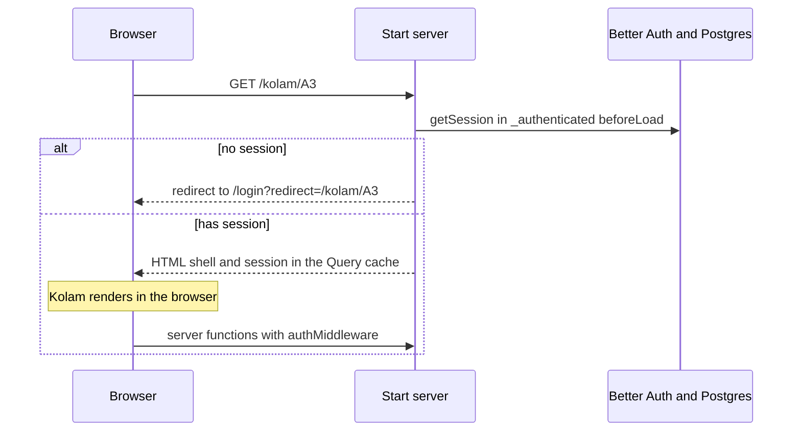

# Architecture

How the app is built today. Product scope is in [product.md](product.md). The pakan model is in [pakan-database-design.md](pakan-database-design.md).

## Stack

Verified from `package.json` and the running layout. Versions below are the ranges this repo declares, not a support promise.

| Piece                                | Role                                                 |
| ------------------------------------ | ---------------------------------------------------- |
| TanStack Start and Router            | File routes, server functions, selective SSR         |
| TanStack Query                       | Server cache                                         |
| TanStack Form                        | Login and the small pakan forms                      |
| TanStack Table and Virtual           | Paged, pinned, virtualized tables                    |
| TanStack Charts                      | Biomass line on a pond                               |
| React 19 and the React Compiler      | UI                                                   |
| Tailwind CSS 4 and shadcn/ui (Radix) | Styling and primitives                               |
| Zustand 5                            | Theme and sidebar, key `arunika-preferences`         |
| Better Auth                          | Username and password sessions                       |
| Prisma 7 and PostgreSQL 18           | Database. Client output is `src/generated/prisma`    |
| Zod 4                                | Request and response schemas                         |
| Storybook 10 and Vitest              | Component stories                                    |
| Nitro                                | Production Node server. The dependency is a beta pin |
| pnpm 11.4.0 and Node 24              | Toolchain                                            |

There is no committed CI workflow. Checks are local.

## Request path

`src/start.ts` sets `defaultSsr: false`. Pages render in the browser. `__root`, `_guest`, and `_authenticated` use `ssr: 'data-only'` so the first request can read the session and redirect before page HTML.

A logged-out `curl -I http://localhost:3000/profile` returns `307` to `/login?redirect=%2Fprofile`. `redirect` is accepted only as a same-origin path.

The route guard is the UI boundary. Private reads and writes also use `authMiddleware` on the server function. A request with no session is sent to `/login`.

## Application pieces

| Path                                    | Responsibility                                              |
| --------------------------------------- | ----------------------------------------------------------- |
| `src/routes/`                           | Guards, loaders, titles. No Prisma calls                    |
| `src/features/auth/`                    | Sign-in, sign-out, session                                  |
| `src/features/dashboard/`               | Beranda counts: users and unexpired sessions                |
| `src/features/pakan/`                   | Feed names, Kolam reads, puasa dadakan, domain calculations |
| `src/features/profile/` and `settings/` | Account display and local preferences                       |
| `src/components/ui/`                    | shadcn primitives                                           |
| `src/components/layout/`                | Shell and sidebar                                           |
| `src/components/shared/`                | Data table and other cross-feature UI                       |
| `src/lib/page.ts`                       | Offset-page Zod factories                                   |
| `prisma/schema.prisma`                  | Users, sessions, and the pakan model                        |
| `scripts/import-pakan-xlsx.ts`          | BATCH 1 workbook load                                       |
| `scripts/create-user.ts`                | Add a user who can sign in                                  |

Imports go one way: routes, then features, then shared folders. A feature does not import another feature or a route. The alias is `#/`.

`*.server.ts` may touch the database. `*.functions.ts` is the `createServerFn` wrapper and is safe to import from the client. Shared Zod schemas stay in plain `.ts` files.

## Data

Auth tables are Better Auth's `User`, `Session`, `Account`, and `Verification`.

Pakan tables are a reference layer (`Pond`, `Feed`, `SeedSource`, `Treatment`, `FeedingRateBand`, `FeedAdditive`), a cycle (`Batch`, `BatchPond`), snapshots (`PondDailyRecord`), and append-only events (stocking, mortality, bibis, feed receipt, feed application, stock opname, treatment log, fasting pattern, fasting override). The entity map is in [pakan-database-design.md](pakan-database-design.md).

Kolam list reads are offset pages. The server still walks the whole pond history before it slices a day page, because population and biomass depend on earlier days. Grafik is a separate read of this pond only. It walks the cycle from the first day, then drops days outside an optional range, and it is not loaded with the page. See [adr/0001-kolam-reads-are-offset-pages.md](adr/0001-kolam-reads-are-offset-pages.md) and the glossary entry for the series.

## State

| Kind                                    | Where                                     |
| --------------------------------------- | ----------------------------------------- |
| Server data                             | TanStack Query                            |
| Shareable UI state (page, sort, search) | The table state passed into the query key |
| Forms                                   | TanStack Form                             |
| One component                           | `useState`                                |
| Theme and sidebar                       | Zustand, persisted in the browser         |

The session is not stored in Zustand.

## Security

- Sign-up is disabled. Accounts are seeded or created with `pnpm user:create`.
- Passwords are stored as hashes. Do not edit `account.password` in Prisma Studio.
- Server functions that read or write private data use `authMiddleware`.
- There is one account type, by decision. A signed-in user can call the same pakan functions as any other signed-in user. There is no farm switcher. Each farm is meant to run its own copy.
- Secrets stay in `.env`, which is gitignored. `.env.example` has empty secrets and local defaults only.

## Limitations

- One deployment, one database, one set of screens.
- Receipts, feed applications, and stock opname have no operator screen. The import script and the feed-usage check are what touch them. Treatment logs have a screen.
- Daily history is replaced when `pnpm db:import` runs again. That command is a developer script, not an upload button.
- `pnpm test:unit` runs domain tests in Node. The treatment server test loads the database only when `DATABASE_URL` is set, and skips otherwise. Story tests need Playwright and stay a local check. There is no GitHub Actions workflow.
- Nitro is pinned to a beta release.
- There is no `LICENSE` file. Reuse is not permitted until one is added.

## Later industries

Do not refactor the fish model in order to sound multi-industry. A poultry or crop cycle needs its own nouns where the fish ones do not fit. What can be copied later is the shape already used here: reference data, a cycle, daily snapshots, append-only events, derived figures that are not stored, and offset pages for lists.

That copy is a proposal. It is not a module boundary in `src/features`.
