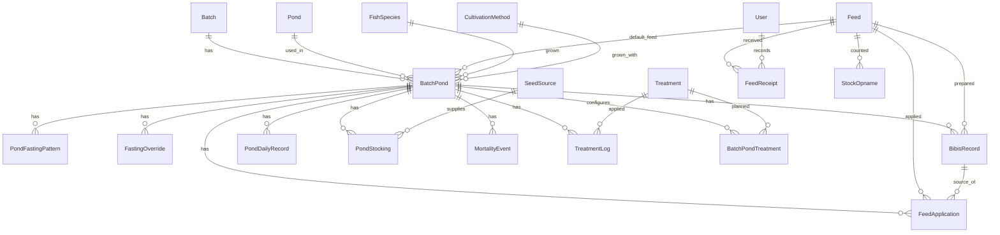
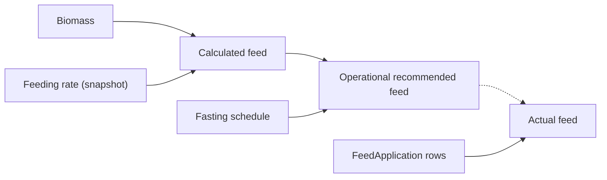

# Pakan database design

This is the domain model for the Pakan (feed and pond) data. The workbook analysis is in [pakan-xlsx-analysis.md](pakan-xlsx-analysis.md). The models are in [prisma/schema.prisma](../prisma/schema.prisma).

The schema and domain rules below are still the model. The app now also has the Kolam screen, the feed list on Beranda, and `pnpm db:import` for BATCH 1. What an operator can do today is in [product.md](product.md).

## Principles

- **Ponds are rows.** There is no table per pond, per sheet, or per treatment.
- **Reference, cycle, snapshot, event.** Reference data says what exists. A cycle ties a pond to a batch. A daily record is a snapshot of observations. Events are things that happened, possibly many times a day.
- **Events are the audit trail.** Every event table is append-only: written once, never updated or deleted. A correction is a new row. There is no separate `ActivityLog`, because it would store each event a second time. A later history screen reads the event tables and merges them by time.
- **Derived values are not stored.** Population, biomass, calculated feed, operational feed, actual feed totals, stock balance, bibis for a day, and FCR are computed from stored inputs.
- **Grams are the canonical unit** for every mass. See [Units](#units).
- **Blank is not zero.** Optional inputs are nullable.

## Entity map



`User` also relates to every event table through `userId`.

## Entities

### Reference and master data

| Model               | Purpose                           | Key fields                                                                                                                   |
| ------------------- | --------------------------------- | ---------------------------------------------------------------------------------------------------------------------------- |
| `Batch`             | One production batch              | `name` unique, `molassesCarbonFraction` (0.37), `plannedSeedWeightGrams` (1000/60), `bibisLeadDays` (default 2)              |
| `Pond`              | A physical pond                   | `code` unique (`A3` to `D6`), `name` (`D3 (Heru)`)                                                                           |
| `Feed`              | Jenis pakan                       | `name` unique (`Safir`, `781`). No stock columns                                                                             |
| `SeedSource`        | Asal bibit                        | `name` unique                                                                                                                |
| `Treatment`         | Treatment master                  | `code` unique, `name` unique. Rows: `MOLASE`, `GOS_STRONG`, `AQUA_CELL`, `BASILUS`                                           |
| `FishSpecies`       | Jenis ikan                        | `code` unique, `name`, optional `scientificName`, `description`, `active`. First row: `NILA` (Nila, _Oreochromis niloticus_) |
| `CultivationMethod` | Metode budidaya                   | `code` unique, `name`, optional `description`, `active`. First row: `BIOFLOC` (Biofloc)                                      |
| `FeedingRateBand`   | Feeding-rate table from Referensi | min and max weight, `frMin`, `frMax`. Unique on min weight                                                                   |
| `FeedAdditive`      | Additive doses from Referensi     | `name` unique, `gramsPerFeedGram`                                                                                            |

Treatment, species, and method names are data, so no screen needs them hard-coded. Treatment rows are written by the import. `NILA` and `BIOFLOC` are inserted by the migration and upserted by the seed and the import.

### Cycle

`BatchPond` is one pond in one batch. Unique on `(batchId, pondId)`. The pond is reused next batch with a new cycle.

Konfigurasi is the plan, and the pond header is what the log used. They disagree in the workbook, and neither is right every time: D3 has 1451 fish (the sheet is right, the plan of 1400 is stale), while A6 to D6 are 28 m3 (the plan is right, the sheet's 7 is a copy error). So the model does not pick a winner by source. The app keeps one actual value per fact, and the import sets it to the confirmed value. The plan is kept only where a comparison is useful:

| Fact                  | Actual (used by the app)       | Plan (reference only)                        |
| --------------------- | ------------------------------ | -------------------------------------------- |
| Fish count            | sum of `PondStocking.quantity` | `plannedSeedCount`                           |
| Volume                | `volumeM3` (28 for A6 to D6)   | none, the plan value is the confirmed value  |
| Feeding and fast days | `PondFastingPattern`           | `plannedFeedDayCount`, `plannedFastDayCount` |

Other cycle fields: `feedId` (default feed), `fishSpeciesId`, `cultivationMethodId`, `densityPerM3`, `aeratorType`, `probiotic` (free text, because the sheet's probiotic values are not treatments), `proteinFraction`, `carbonFraction`, `nitrogenFraction` (typed on each pond header, so they belong to the cycle and not to `Feed`), and `notes`.

Species and method belong on the cycle, not on the physical pond. The next batch can grow a different fish or use a different method, and an old cycle keeps the rows it was stocked with. Both foreign keys are required. The migration inserts `NILA` and `BIOFLOC` if those codes are missing, fills every existing cycle from those codes, then makes the columns required. `pnpm db:seed` upserts the same codes and does not add a second row. `pnpm db:import` does the same before it recreates BATCH 1, because a cycle cannot be saved without them.

Add another species or method by inserting a row with a new `code`. The Kolam header reads the names from those rows. The names are not hard-coded in the screen.

`BatchPondTreatment` lists which treatments the plan uses on a cycle. It replaces the Molase and Basilus yes/no columns. Unique on `(batchPondId, treatmentId)`.

### Daily snapshot

`PondDailyRecord`: unique `(batchPondId, doc)`. Holds the observations for one day of culture: `observedOn`, `averageWeightGrams`, `floc`, `ph`, `tds`, `dissolvedOxygen`, `temperatureC`, and the snapshotted `frMin` and `frMax`. It is updated in place for that day. It does not hold deaths, feed, molase, or treatment text, because those can happen several times a day and live in event tables.

`frMin` and `frMax` are copied from `FeedingRateBand` when the weight is entered. The workbook looks the band up live, so editing `Referensi` rewrites every old row. The app does not: history stays the same when the table changes. This is deliberate and differs from the workbook.

### Events

| Model             | Event                         | Quantity                          | Time                      |
| ----------------- | ----------------------------- | --------------------------------- | ------------------------- |
| `PondStocking`    | Fish put into a cycle         | `quantity` (ekor), `seedSourceId` | `occurredOn` (date)       |
| `MortalityEvent`  | Deaths                        | `quantity` (ekor)                 | `occurredAt`              |
| `FeedApplication` | Feed actually given to a pond | `quantityGrams`                   | `occurredAt`              |
| `FeedReceipt`     | Feed arriving into stock      | `quantityGrams`                   | `occurredAt`              |
| `StockOpname`     | Physical stock count          | grams, three columns              | `occurredAt`              |
| `TreatmentLog`    | A treatment applied           | `quantityGrams`                   | `occurredAt`              |
| `FastingOverride` | Emergency fasting             | none                              | `startsAt`, `endsAt`      |
| `BibisRecord`     | Bibis the user prepared       | `quantityGrams`                   | `preparedAt`, `feedingOn` |

Each event row has `userId` and `createdAt`. Two entries on one day stay as two rows.

## Fasting

Two separate concepts.

**Recurring pattern.** `PondFastingPattern` has `feedDayCount`, `fastDayCount`, `anchorOn`, and `effectiveFrom`. `6:1` is stored as `6` and `1`; the `6:1` text is only formatted for display. Unique on `(batchPondId, effectiveFrom)`. The pattern in force on a date is the one with the latest `effectiveFrom` on or before it. Changing a pond's pattern adds a row, so old days keep their old pattern.

Cycle day, 1-based:

```
((date - anchorOn) mod (feedDayCount + fastDayCount)) + 1
```

Days `1` to `feedDayCount` are feeding days. The rest are fasting days. For `6:1` the cycle is 7 days and day 7 is the fasting day.

**Emergency override.** `FastingOverride` has `startsAt`, `endsAt`, `reason`, optional `note`, `userId`, `createdAt`, and optional `revokedAt` and `revokedById`. The interval is half-open: `[startsAt, endsAt)`. "Fast from Oct 10 through Oct 12" is stored with `endsAt` at 2026-10-13 00:00 in Asia/Jakarta. A calendar day in Asia/Jakarta is overridden when the interval overlaps any part of it. Ending an override early sets `revokedAt` and does not delete the row.

The override never edits the pattern and does not move `anchorOn`. When the override ends, the recurring cycle continues as if nothing happened.

**One rule.** `getPondFeedingSchedule` in [src/features/pakan/domain/feeding-schedule.ts](../src/features/pakan/domain/feeding-schedule.ts) is the only place that decides whether a pond is fasting. It takes plain data and has no database access, so queries, API handlers and components all call it and none repeats the rule. It returns:

| Field                            | Meaning                                                              |
| -------------------------------- | -------------------------------------------------------------------- |
| `isFasting`, `isFeedingDay`      | Opposites                                                            |
| `cycleDay`                       | Day in the recurring cycle, or `null` when no pattern is in force    |
| `fastingReason`                  | `OVERRIDE`, `RECURRING`, or `null`. An override wins when both apply |
| `override`                       | The override that applies, with its reason, or `null`                |
| `nextFeedingOn`, `nextFastingOn` | The first such day strictly after the date, or `null`                |

With no pattern in force, a pond is treated as feeding every day until an override says otherwise.

## Feed amounts

The three amounts stay separate and none overwrites another.



| Amount                       | Definition                                                                                | Stored?   |
| ---------------------------- | ----------------------------------------------------------------------------------------- | --------- |
| Calculated feed              | `average(frMin, frMax) * biomass`, as in workbook column `I`. Does not know about fasting | No        |
| Operational recommended feed | `0` on a fasting day, otherwise the calculated feed rounded half up to a whole gram       | No        |
| Actual feed                  | Sum of `FeedApplication.quantityGrams` for the cycle and the Asia/Jakarta calendar day    | No, a sum |

Example: calculated 5200 gr, fasting true, operational 0 gr. The reason is `fastingReason` from the schedule. The 5200 is still available for FCR.

FCR uses actual feed, which the user enters by hand as `FeedApplication` rows: total actual feed divided by the change in biomass (latest biomass minus initial biomass). This differs from the workbook, whose `G5` sums the recommended column `I`. The change is deliberate. A negative FCR (biomass fell) is left as it is, and FCR is blank while no actual feed has been recorded.

Population keeps the workbook rule: if the average weight is blank, population and biomass are blank even when deaths exist. Population on a date is stocked fish on or before that date, minus deaths up to it.

## Bibis

Bibis is feed prepared ahead. `Batch.bibisLeadDays` (default 2) is the lead time.

`feedingOn = prepareOn + bibisLeadDays`. The quantity is the operational recommended feed for `feedingOn`. So a fasting `feedingOn`, from the pattern or an override, gives `0`.

**The to-do is calculated, not stored.** The dashboard shows a list such as "today, bibis 7500 gr for A3". Nobody creates or cancels a plan row. `getBibisForDay` in the same domain file builds the list every time it is asked. For each active cycle it calls `getPondFeedingSchedule` for `feedingOn`, so a recurring fast day or a new override changes the list on its own.

Per pond it returns `requiredGrams` (0 when fasting), `fastingReason` when that is why it is 0, `preparedGrams` (already recorded), and `remainingGrams` (required minus prepared, never below 0). It also returns the day totals. `preparedButNotNeeded` is true when something was prepared and the feeding day later became a fast day.

**The user records what they did.** `BibisRecord` is one append-only row each time bibis is prepared:

| Field                                | Note                                                    |
| ------------------------------------ | ------------------------------------------------------- |
| `batchPondId`, `feedId`, `feedingOn` | Which pond, which feed, and which feeding day it is for |
| `quantityGrams`                      | Integer grams actually prepared                         |
| `preparedAt`, `userId`               | When and who                                            |
| `note`                               | Optional                                                |

Rules:

- Several records for the same `feedingOn` are allowed. Their sum is `preparedGrams`.
- There are no statuses. `PLANNED`, `CANCELLED`, `SKIPPED` and `USED` are not needed, because the plan is calculated. Whether a day is done is `remainingGrams = 0`.
- A record is never deleted or changed. If the pond starts fasting after bibis was prepared, the record stays and the day shows `preparedButNotNeeded`.
- `FeedApplication.bibisRecordId` is an optional link from the feed given to the bibis it came from.

## Inventory

There is no `currentStock` column.

```
current stock = sum(FeedReceipt) - sum(FeedApplication) + sum(StockOpname.adjustmentGrams)
```

Per feed. Opening stock for a period is the same sum before the period.

- `FeedReceipt`: grams in.
- `FeedApplication`: grams out. It is the same row that records actual feed on a pond. Stock out is not typed twice.
- `StockOpname`: `systemQuantityGrams` (what the system said at that moment), `physicalQuantityGrams`, and `adjustmentGrams` (`physical - system`). The system quantity is a snapshot on purpose: it keeps the count auditable even if a later receipt is recorded with an earlier time.

Worked example: opening `100000`, received `50000`, applied `20000`, opname `-5000` gives `125000`. An opening count is a `StockOpname` with `systemQuantityGrams = 0`.

A generic movement table was considered and rejected. Feed in, feed out, and adjustment each have a different owner and a different set of columns, and `FeedApplication` is already needed on the pond. A second movement row for each application would duplicate it. Receipts, applications, and opnames are three clear sources, so the balance is a sum over three tables.

Old receipts and applications are never edited to make a count match.

## Treatments

`Treatment` is the master. `TreatmentLog` is the event: `treatmentId`, `batchPondId`, `quantityGrams`, `occurredAt`, `userId`, optional `note`. The batch comes from the cycle. There are no `molaseAmount` or `gosStrongAmount` columns.

Only the `MOLASE` treatment feeds the molase-carbon formula: grams times `Batch.molassesCarbonFraction`. CN ratio is `(feed carbon + molase carbon) / feed nitrogen`.

The workbook's free-text column `U` is not a model. A later import may turn rows into `TreatmentLog` entries where the text is clear.

## Stocking and mortality

`PondStocking` records every time fish enter a cycle, with `seedSourceId`. The first stocking is the opening count. A later addition is another row, so a pond can have several origins. Jumlah bibit is the sum. `MortalityEvent` holds each death count. Population is stocked minus died. Both are in ekor, not grams.

## Why no ActivityLog

The earlier design had a generic `ActivityLog` that pointed at specialized rows. That stored each business fact twice (the quantity once on the specialized row and once on the log row), so they could drift apart. The specialized event tables are already append-only and carry user and time. A history screen can read them directly with a union query. Nothing is lost, and each fact has one home.

## Units

All masses are stored as integer grams.

| Value                                                | Type                                                 |
| ---------------------------------------------------- | ---------------------------------------------------- |
| Feed received, applied, bibis, opname, treatment     | `Int` grams                                          |
| Fish average weight                                  | `Decimal` grams, because samples are not whole grams |
| Feeding-rate and carbon, protein, nitrogen fractions | `Decimal` fractions                                  |
| Fish counts                                          | `Int` ekor                                           |

No strings such as `7.5 kg` are stored. Importing kilograms multiplies by 1000 (`7.5 kg` is `7500`). Formatting for display is a UI concern.

Operational feed is rounded half up to a whole gram. Calculated feed stays unrounded in calculation.

Prisma has no check constraints, so `20261003103052_pakan_checks` adds them as SQL: event quantities `> 0`, stock opname quantities `>= 0`, `feedDayCount >= 1`, `fastDayCount >= 0`, `bibisLeadDays >= 0`, `doc >= 1`, `endsAt > startsAt`, and `adjustmentGrams = physicalQuantityGrams - systemQuantityGrams`. The application validates the same rules first so users see a message instead of a database error.

## Normalization decisions

- Master data (`Feed`, `SeedSource`, `Treatment`, `Pond`) is referenced by id, so names are never copied into events.
- Fasting pattern and override are separate tables because they change at different times and for different reasons.
- Fish count and feed-day counts keep a plan column beside the actual value, because the plan is a different fact, not a duplicate. Volume has one column, because the plan and the sheet were the same fact and one was wrong.

Intentional denormalization, each with a reason:

| Copy                                                              | Why                                                                      |
| ----------------------------------------------------------------- | ------------------------------------------------------------------------ |
| `PondDailyRecord.frMin`, `frMax`                                  | History must not change when `FeedingRateBand` is edited                 |
| `StockOpname.systemQuantityGrams`                                 | The count must show what the system said at that moment                  |
| `BatchPond.proteinFraction`, `carbonFraction`, `nitrogenFraction` | Typed per pond in the workbook, and the same brand uses different values |
| `StockOpname.adjustmentGrams`                                     | Cheap to sum, derived from the two quantities, protected by a check      |

## Workbook mapping

| Workbook                                          | Model                                                                   |
| ------------------------------------------------- | ----------------------------------------------------------------------- |
| `Referensi` bands                                 | `FeedingRateBand`                                                       |
| `Referensi` additives                             | `FeedAdditive`                                                          |
| `Konfigurasi` column                              | `BatchPond` plan fields and `BatchPondTreatment`                        |
| Pond sheet header                                 | `BatchPond` actual fields, `PondFastingPattern`, and one `PondStocking` |
| Header `Asal Bibit`, `D4`, `G2`                   | `SeedSource`, `PondStocking.quantity`, `PondStocking.occurredOn`        |
| Header `Puasa`                                    | `PondFastingPattern`                                                    |
| Column `C`                                        | `PondDailyRecord.averageWeightGrams`                                    |
| Columns `D`, `E`                                  | `PondDailyRecord.frMin`, `frMax` snapshot                               |
| Column `F`                                        | `MortalityEvent`                                                        |
| Column `L`                                        | `TreatmentLog` with `MOLASE`                                            |
| Column `T`                                        | `FeedApplication`                                                       |
| Columns `P` to `S`, `O`                           | `PondDailyRecord`                                                       |
| Column `U`                                        | not modeled                                                             |
| Columns `G`, `H`, `I`, `J`, `K`, `M`, `N`, totals | derived                                                                 |
| `Master - Pakan`, `Sheet8`                        | not modeled                                                             |

## Questions the model answers

| Question                                                                              | Source                                                    |
| ------------------------------------------------------------------------------------- | --------------------------------------------------------- |
| Is A3 fasting today? Why? Recurring or override? Current cycle day? Next feeding day? | `getPondFeedingSchedule(cycle, today)`                    |
| Calculated recommended feed in grams                                                  | biomass and snapshotted `frMin`, `frMax`                  |
| Operational recommended feed after fasting                                            | calculated feed and `isFasting`                           |
| How much feed was given? Several times today?                                         | `FeedApplication` rows for the day, sum and count         |
| Current stock                                                                         | receipts, applications, opname adjustments                |
| What was received? Consumed? Adjusted?                                                | `FeedReceipt`, `FeedApplication`, `StockOpname`           |
| What to prepare today, for which pond and date, how many grams                        | `getBibisForDay(today)`                                   |
| Already prepared? Cancelled because of fasting?                                       | `BibisRecord` sum vs required, `preparedButNotNeeded`     |
| Which treatment, pond, time, user, grams, how many today                              | `TreatmentLog` joined to `Treatment`, `BatchPond`, `User` |

## Assumptions and open questions

- Dates and days use Asia/Jakarta (UTC+7, no daylight saving).
- The cycle counter keeps running through an emergency fast.
- A pattern's `anchorOn` is set by the operator. The workbook does not say when a cycle starts, so default is the first stocking date.
- A single `feedId` per bibis record. A pond that mixes brands on one day needs two records, and the model allows that.
- Confirmed: FCR uses actual feed entered by hand.
- Confirmed: D3 has 1451 fish and A6 to D6 are 28 m3. The import writes those, not the conflicting copy.
- Confirmed: D3 puasa is `6:1` (Konfigurasi). The sheet header `5:1` was stale. Carbon fractions follow each pond sheet (C6 is `0.35`).
- Treatment master rows and the unit for each (everything is grams now) need confirmation.
- Vitamin C is `0.1` g per kg in `Referensi` and `0.15` in the `Konfigurasi` sentence. The additive row uses `Referensi`.
