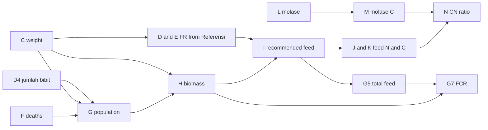

# Pakan workbook analysis

Source: `Copy of Manajement Pakan - BATCH 1.xlsx` in the repo root. This document describes what the workbook does today. It does not describe the database. See [pakan-database-design.md](pakan-database-design.md) for that.

No rows are imported from the workbook in this step.

## Sheets

The file has 12 sheets.

| Sheet                                                                         | Role                                                                                                                               | Modeled?                         |
| ----------------------------------------------------------------------------- | ---------------------------------------------------------------------------------------------------------------------------------- | -------------------------------- |
| `Referensi`                                                                   | Feeding-rate bands by fish weight, plus additive doses per 1000 g of feed                                                          | Yes, as reference data           |
| `Konfigurasi`                                                                 | One column per pond: the plan for aerator, molase, basilus, density, volume, population, seed weight, puasa, feed brand, probiotic | Yes, as plan fields on the cycle |
| `Master - Pakan`                                                              | An unused prototype (`PENCATATAN KOLAM A`, 100 seed). Not a pond and not a stock table                                             | No                               |
| `Kolam A3`, `B3`, `C3`, `Kolam D3  Heru` (two spaces), `A6`, `B6`, `C6`, `D6` | The same daily log copied eight times                                                                                              | Yes, as rows, not tables         |
| `Sheet8`                                                                      | A mortality matrix and two charts. Its totals all sum the A3 column, so they are wrong                                             | No, ignored                      |

A pond is a row of data. The model must not create one table per pond or per sheet.

The batch name appears only in the file name (`BATCH 1`).

## Referensi

- Feeding bands in `C5:G11`: minimum weight, maximum weight, FR min, FR max, and an average in `G`. Rates are fractions (`0.05` is 5%).
- Additives in `I2:K7`, as grams per 1000 g of feed. Vitamin C and Vitamin B are `0.0001`, Lysin is `0.003`, Asam Amino is `0.002`.
- Planned seed weight on `Konfigurasi` is `1000/60`, about 16.67 g.
- `J13:K18` is an unlabeled scratch table. Only `J17` sums it. It is not a model.

## Konfigurasi

Columns `C` to `J` are `A3`, `B3`, `C3`, `D3 (Heru)`, `A6`, `B6`, `C6`, `D6`.

| Pond      | Aerator  | Molase | Basilus | Density | Volume m3 | Planned population | Puasa | Feed  | Probiotik    |
| --------- | -------- | ------ | ------- | ------- | --------- | ------------------ | ----- | ----- | ------------ |
| A3        | Diffuser | No     | Yes     | 200     | 7         | 1400               | 5:1   | Safir | Vit. C       |
| B3        | Uniring  | Yes    | Yes     | 175     | 7         | 1225               | 5:1   | 781   | Vit.C + Jamu |
| C3        | Diffuser | Yes    | Yes     | 175     | 7         | 1225               | 6:1   | Safir | Jamu         |
| D3 (Heru) | Uniring  | No     | No      | 200     | 7         | 1400               | 6:1   | 781   | -            |
| A6        | Diffuser | Yes    | Yes     | 200     | 28        | 5600               | 6:1   | 781   | -            |
| B6        | Uniring  | Yes    | Yes     | 175     | 28        | 4900               | 6:1   | Safir | -            |
| C6        | Diffuser | Yes    | Yes     | 175     | 28        | 4900               | 5:1   | 781   | -            |
| D6        | Uniring  | Yes    | Yes     | 200     | 28        | 5600               | 5:1   | Safir | -            |

`C18:C19` also holds a sentence: `0.15 gram vitamin C / KG Pakan`.

No formula in the workbook reads `Konfigurasi`. It is a plan. Each pond sheet copies its own header values.

## Pond sheet header

Rows 2 to 8 are the header. The values below are typed unless a formula is listed.

| Cell                                 | Label             | Notes                                                                                                                            |
| ------------------------------------ | ----------------- | -------------------------------------------------------------------------------------------------------------------------------- |
| `G2`                                 | Tanggal Tebar     | Text (`20-Sept-2026`, `20-Sept-26`), an Excel serial, or blank (`C6`, `D6`). Serial base is 1899-12-30, so `46285` is 2026-09-20 |
| `J2`                                 | Asal Bibit        | One text value per pond: `Kang Ipey - Subang` or `Cibinong`                                                                      |
| `N2`                                 | Pakan             | Brand text: `Safir` or `781`                                                                                                     |
| `D4`                                 | Jumlah Bibit      | One number. Seeds added on a later date have no place in the sheet                                                               |
| `N4`                                 | Puasa             | Text such as `5:1` or `6:1`                                                                                                      |
| `J4`                                 | Protein           | `0.32` on every pond                                                                                                             |
| `J5`                                 | Carbon            | Typed fraction. Varies: `0.17` or `0.35`                                                                                         |
| `J6`                                 | Nitrogen          | `0.05`, typed. Not `0.32 / 6.25`, which is about `0.0512`                                                                        |
| `M6`, `M7`                           | Note              | Free text, for example `Tanpa Molase, gunakan gostrong & Aquacell` on A3                                                         |
| `D8`                                 | Volume Kolam (M3) | `7` on every pond, including A6 and B6                                                                                           |
| `D5`, `D6`, `D7`, `G4` to `G8`, `J8` | Totals            | Formulas, see below                                                                                                              |

Asal Bibit per pond: A3, B3, A6, C6, D6 are `Kang Ipey - Subang`. C3, D3 and B6 are `Cibinong`.

Header formulas:

- `G4` initial biomass is `C13 * D4`. `Master - Pakan` uses `10 * D4`.
- `D5` total mortality is the sum of `F`.
- `D6` current population is the latest `G`. `D7` survival rate is `D6 / D4`.
- `G5` total feed is `SUM(I)`, the recommended column, not `SUM(T)`.
- `G6` and `J8` are Google Sheets `FILTER` / `CHOOSEROWS` formulas saved as `__xludf.DUMMYFUNCTION` plus a cached number. They return the last non-empty, non-zero value. Their ranges stop near row 161, while the sums go to row 164.
- `G7` FCR is `IFERROR(G5 / (G6 - G4), 0)`. It can be negative. `D3` is `-6.48`. Do not clamp it.
- `G8` is `IF(G6 = 0, "", J8 * G6)`.

## Daily rows

Rows start at 13. DOC 1 to 152 are filled with formulas down to the end of the sheet. Most rows are empty templates. Only some rows hold typed input.

| Col        | Label                | Kind           | Notes                                                                                      |
| ---------- | -------------------- | -------------- | ------------------------------------------------------------------------------------------ |
| `A`        | Date                 | Typed serial   |                                                                                            |
| `B`        | DOC                  | Typed 1 to 152 | Day of culture                                                                             |
| `C`        | Berat Rata-Rata (gr) | Input          |                                                                                            |
| `D`        | FR min               | Derived        | `VLOOKUP` into `Referensi!C5:F11`. If the looked-up value is greater than 1, divide by 100 |
| `E`        | FR max               | Derived        | Same lookup                                                                                |
| `F`        | Kematian             | Input          | Deaths                                                                                     |
| `G`        | Populasi             | Derived        | DOC 1 `$D$4 - F`. Later `IF(C = "", "", prevG - F)`                                        |
| `H`        | Biomassa             | Derived        | `C * G`, blank when `C` is blank                                                           |
| `I`        | Feeding Rate (gr)    | Derived        | Recommended feed: `AVERAGE(D, E) * H`                                                      |
| `J`        | Pakan N              | Derived        | `I * $J$6`                                                                                 |
| `K`        | Pakan C              | Derived        | `I * $J$5`                                                                                 |
| `L`        | Molase berat (gr)    | Input          |                                                                                            |
| `M`        | Molase C             | Derived        | `L * 37%`                                                                                  |
| `N`        | CN Ratio             | Derived        | `IF(J = 0, "", (K + M) / J)`                                                               |
| `O`        | Intensitas Flok      | Input          | Empty in the file                                                                          |
| `P` to `S` | pH, TDS, DO, Temp    | Input          |                                                                                            |
| `T`        | Actual Pakan         | Input          | Feed actually given                                                                        |
| `U`        | Additional Treatment | Input          | Free text                                                                                  |

Findings that affect the model:

- **Recommended feed is not typed.** Column `I` is a shared formula (`<f t="shared" si="N" ref="...">` on the first cell, an empty `<f t="shared" si="N"/>` on dependents, plus a cached value). An empty shared `<f>` is not a typed value.
- **Exceptions in column I.** DOC 1 and early days are a literal `0`. `Kolam A6!I15` is `T15`. From `A6` row 22 onward the formula is `D * H`, FR min only.
- **Actual feed is column `T`.** A3's column `T` sums to 0 while its `G5` is 10792.35, because `G5` sums column `I`.
- **Blank weight blanks population.** `G` and `H` are blank when `C` is blank, even if `F` has a death. `Kolam A3!F24` is an example.
- **Cached `#N/A`.** `Kolam C6!D13:E13` cache `#N/A`, because the weight is 0 and the lookup finds no band. These are not typed values and are not treated as errors to repair.
- **Molase is 37% carbon** on every sheet. Formulas use the literal `37%`.
- **No data validations, no conditional formatting.**
- **Puasa is never read.** `N4` is header text. No daily formula, including recommended feed, reads it. The workbook does not set recommended feed to zero on a fasting day.
- **Floc (`O`) is empty.**
- **Uneven input.** A3 has 59 rows with some typed input and mortality through about DOC 25. C6 and D6 have almost none. An import must keep a row only when someone typed a value.

## Dependency chain

`T` actual feed and `U` treatment feed nothing.

## Classification

| Group                    | Items                                                                                                            |
| ------------------------ | ---------------------------------------------------------------------------------------------------------------- |
| Reference                | FR bands, additive doses, the molase carbon fraction `37%`                                                       |
| Plan (Konfigurasi)       | Aerator, molase, basilus, density, volume, population, planned seed weight, puasa, feed brand, probiotic         |
| Cycle header (pond copy) | Tanggal tebar, asal bibit, jumlah bibit, volume, puasa, feed, protein, carbon, nitrogen, note                    |
| Daily input              | Weight, deaths, molase, floc, pH, TDS, DO, temperature, actual feed, treatment text                              |
| Derived                  | FR min and max, population, biomass, recommended feed, N, C, molase C, CN ratio, SR, FCR, totals, latest biomass |

## Issues recorded, not fixed

- **Volume.** `A6` to `D6` are 28 m3 in `Konfigurasi` and `7` on `D8` of their pond sheets (as on every pond sheet). Confirmed: 28 m3 is right and the sheet value is a copy error. Daily math does not use the volume cell.
- **Seed count and puasa on D3.** `D3` has 1451 on the sheet and 1400 in `Konfigurasi`. Confirmed: 1451 is right. Its sheet puasa is `5:1`, while `Konfigurasi` says `6:1`. Confirmed: `6:1` is right, so the pond header copy is stale here.
- **Carbon fraction.** `A3`, `C3`, `D6` use Safir with `0.17`. `B6` is Safir with `0.35`. `C6` is `0.35` (brand 781). Confirmed: follow each pond sheet. The brand does not fix the fraction, so the fraction belongs to the cycle.
- **Vitamin C.** `Referensi` gives `0.0001 * 1000 g = 0.1 g` per kg. The `Konfigurasi` sentence says `0.15 g` per kg.
- **A6 recommended feed.** The formula changes: a literal `0`, then one cell equal to actual feed, then average of FR min and max, then FR min only.
- **Master - Pakan.** Initial biomass is `10 * D4`, and FR uses `XLOOKUP` rather than `VLOOKUP`.
- **FCR sign.** FCR is negative when biomass falls (`D3`, `B3`, `C3`, `Master - Pakan`). That is existing behavior.
- **Sheet8.** `L3:S3` all use `SUM(C3:C13)`, so every total is the A3 column. Chart 1 is `Trend Kematian September` (`B3:J13`). Chart 2 is `Total Kematian Ikan` (`L2:S3`). The sheet is ignored.
- **Floc.** A real column, currently empty.

## Business rules that are not in the workbook

These come from the operators and define app behavior. They are not computed anywhere in the file.

- **Puasa `6:1`** means 6 feeding days followed by 1 fasting day, repeating. `5:1` means 5 feeding days followed by 1 fasting day.
- **Fasting** sets operational recommended feed to `0 gr`. The calculated amount from biomass and feeding rate is kept.
- **Emergency fasting** is a dated exception to the recurring cycle.
- **Bibis** is feed prepared about 2 days before it is given. It follows the pond's feeding schedule. The amount to prepare is calculated and shown as a to-do. The user then records what they prepared.
- **FCR** uses actual feed that the user enters by hand, not the recommended column.
- **Later stocking.** Fish can be added on later dates, and asal bibit can differ per addition.
- **Feed received, stock opname, treatment names** (`Molase`, `Gos Strong`, `Aqua Cell`, `Basilus`) and multiple events per day are product requirements, not workbook content. `A3`'s note mentions `gostrong` and `Aquacell` in free text.

## Open questions

- Resolved: the app calculates FCR from actual feed (`T`, entered by hand), not recommended feed (`I`). This differs from the workbook.
- Resolved: 28 m3 is right for `A6` to `D6`.
- Resolved: `1451` is right for `D3`.
- Resolved: carbon fractions follow each pond sheet (`C6` is `0.35`).
- Is Vitamin C `0.1` or `0.15` g per kg?
- Do `C6` and `D6` hold placeholders only?
- Neither source wins every time (D3 count: sheet right; A6 to D6 volume: Konfigurasi right), so the model keeps one actual value per fact. See the design doc.
- Does the first `puasa` day fall at the end of each block, or does the pond reset at stocking? The model anchors the cycle on a date. Operators can set the anchor.
- Is treatment free text in `U` worth parsing into treatment logs at import?
